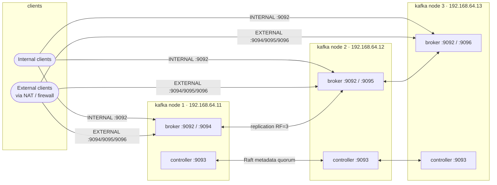

# kafka-kraft-3node

One Bash script that installs a **3-node Apache Kafka 4.3 cluster in KRaft mode** (no
ZooKeeper) from an admin host over SSH, **air-gapped**: JDK and Kafka come from local tarballs.
Every node is both **broker and controller**, so 3 VMs give a Raft quorum and replicated topics.



| Item | Value |
|---|---|
| Kafka | 4.3.1 (`kafka_2.13-4.3.1.tgz`), KRaft only |
| Java | JDK 17 (`jdk-17.0.19_linux-x64_bin.tar.gz`) → `/usr/local/jdk-17.0.19` |
| Install dir | `/APP/kafka`, data in `/APP/kafka/kafka-logs` |
| Service | `kafka.service`, user `kafka` (system account, no login), heap 8 GB, `LimitNOFILE=100000` |
| OS | RHEL-family (Oracle Linux / Rocky / RHEL) |

## Ports

| Port | Listener | Who uses it |
|---|---|---|
| 9092 | `INTERNAL` (PLAINTEXT) | Inter-broker replication, clients inside the network |
| 9093 | `CONTROLLER` (PLAINTEXT) | Raft quorum between controllers, `kafka-metadata-quorum.sh` |
| 9094 / 9095 / 9096 | `EXTERNAL` (PLAINTEXT), one port **per node** | Clients from outside, typically through one NAT/firewall IP |

## How to run

On an admin host (root, SSH key `/root/.ssh/id_ed25519` authorised on all 3 nodes):

```bash
# 1. Put the tarballs next to the script (not in git)
ls jdk-17.0.19_linux-x64_bin.tar.gz kafka_2.13-4.3.1.tgz

# 2. One IP per line, in node order
cat ip_list.txt
192.168.64.11
192.168.64.12
192.168.64.13

# 3. Install
./install_kraft.sh
```

What it does, in order:

1. Reads `ip_list.txt` → node 1, 2, 3, external port 9094, 9095, 9096.
2. On node 1: unpacks JDK + Kafka and runs `kafka-storage.sh random-uuid` → `CLUSTER_ID`.
   On a re-run, it reads `cluster.id` back from node 1's `meta.properties` instead.
3. Builds `controller.quorum.voters=1@ip1:9093,2@ip2:9093,3@ip3:9093`.
4. For each node: scp tarballs → disable SELinux/firewalld → generate `server.properties` →
   `kafka-storage.sh format` (only if the data dir is empty) → systemd unit → `restart` → status.

## How to verify

```bash
# Raft quorum: 1 leader, 3 voters, lag 0
/APP/kafka/bin/kafka-metadata-quorum.sh --bootstrap-controller 192.168.64.11:9093 describe --status
/APP/kafka/bin/kafka-metadata-quorum.sh --bootstrap-controller 192.168.64.11:9093 describe --replication --human-readable

# Versions
/APP/kafka/bin/kafka-server-start.sh --version     # 4.3.1
java -version                                      # 17.0.19

# End to end: RF 3, survives 1 broker down
/APP/kafka/bin/kafka-topics.sh --bootstrap-server 192.168.64.11:9092 --create --topic smoke --partitions 3 --replication-factor 3
/APP/kafka/bin/kafka-topics.sh --bootstrap-server 192.168.64.11:9092 --describe --topic smoke   # Isr = 3 replicas
```

More in [runbooks/operations.md](runbooks/operations.md): produce/consume test, rolling restart,
rebuilding a node, kernel tuning.

## Design decisions

| Decision | Why |
|---|---|
| KRaft, no ZooKeeper | Kafka 4.x removed ZooKeeper. One system to run, metadata in a Raft log inside Kafka itself. |
| 3 nodes, **combined** broker + controller | 3 voters tolerate 1 failure, with 3 VMs instead of 6. Fine for small/medium clusters. Large clusters separate controllers so broker load cannot starve the quorum. |
| Static `controller.quorum.voters` from `ip_list.txt` | The voter set is visible in plain text in every `server.properties`. Changing membership is a planned operation, not something that drifts. |
| `default.replication.factor=3`, `min.insync.replicas=2` | With `acks=all`, a write is confirmed by 2 of 3 replicas: 1 broker can be down without losing acknowledged data or blocking producers. |
| Internal topics (`__consumer_offsets`, transactions) RF 3 / min ISR 2 | Consumer offsets and transactions get the same durability as data. |
| Separate `INTERNAL` and `EXTERNAL` listeners, one external port per node | Replication stays on the internal network. Behind a single NAT IP, port 9094/9095/9096 maps to node 1/2/3, so each broker can still advertise a unique address. |
| One `CLUSTER_ID`, generated once, reused on re-runs | A node formatted with another ID refuses to join (`Invalid cluster.id`). The script reads the existing ID from node 1 before generating one. |
| `format` only when the data dir is empty | Re-running the installer never wipes data. |
| systemd: dedicated `kafka` user, `Restart=on-failure`, `LimitNOFILE=100000` | Kafka holds a file handle per segment and per connection. The default 1024 runs out fast. |
| Fixed heap 8 GB | Kafka relies on the **page cache** for reads, not the heap. A small, fixed heap leaves the rest of RAM to the OS. Sized for nodes with 16 GB+. |
| Tarballs, not packages | Same JDK/Kafka on every node, works without internet or a repo mirror. |

## Troubleshooting

| Symptom | Likely cause | Check / fix |
|---|---|---|
| `Invalid cluster.id in .../meta.properties` | Node formatted with another `CLUSTER_ID` | Compare `cluster.id` in `meta.properties` on all nodes. Stop the bad node, empty its data dir, re-run the script |
| `describe --status` hangs / no `LeaderId` | Fewer than 2 controllers reachable on 9093 | `ss -ltnp \| grep 9093` on each node, firewall between nodes |
| Producer `NOT_ENOUGH_REPLICAS` | Fewer than `min.insync.replicas` (2) replicas in sync | `kafka-topics.sh --describe --under-replicated-partitions` |
| Clients connect, then time out | Client cannot reach the **advertised** address (`EXTERNAL://<ip>:909x`) | The address in `advertised.listeners` must be reachable from the client, NAT included |
| Service starts and exits | Wrong `JAVA_HOME`, or data dir owned by root | `journalctl -u kafka -n 50`, `ls -ld /APP/kafka/kafka-logs` |
| `Too many open files` | `LimitNOFILE` not applied | `cat /proc/$(pgrep -f kafka.Kafka)/limits` |
| Only 2 voters in `server.properties` | `ip_list.txt` last line without newline (old script) | Fixed: the parser now reads it. Check `controller.quorum.voters` |

## Bugs I fixed while publishing this

| Before | Now |
|---|---|
| New `CLUSTER_ID` on every run: a rebuilt/new node got a different ID and could not join | Reuse the ID from node 1's `meta.properties` |
| Last line of `ip_list.txt` without a trailing newline was skipped → 2-node "cluster" | `while read -r ... \|\| [[ -n ... ]]` |
| `kafka` user had password `kafka123`, a login shell and `wheel` (sudo) | System account, `/sbin/nologin`, no password, no sudo |
| No `set -euo pipefail`: a failed `scp` let the install continue | Fail fast |
| `declare -A`: nodes processed in random order, bash 4+ only | Indexed arrays: node order 1→3, runs on bash 3.2 too |

## Next steps

- TLS + SASL (SCRAM) on all listeners, ACLs. Today everything is PLAINTEXT.
- Keep firewalld/SELinux on and open only 9092-9096. The script disables both.
- Separate controllers (3 small nodes) when the broker count grows.
- Dynamic quorum (`controller.quorum.bootstrap.servers`, `kafka-storage format --initial-controllers`) to add/remove controllers without editing every config.
- JMX exporter → Prometheus/Grafana.
- Licensing: Oracle JDK 17 updates after Sept 2024 are not free for production. Use Eclipse Temurin 17/21.
- Data on its own disk (`log.dirs`) instead of under the install directory.

## License

[MIT](LICENSE)
